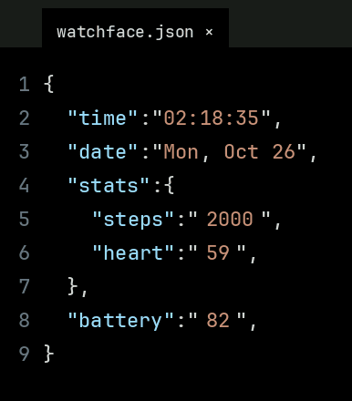
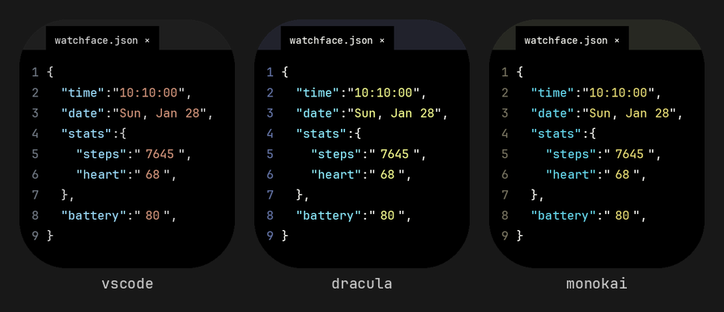

# JSON Watchface

<p align="center">
  
  
  
  
  
  
</p>

A watch face for **Amazfit Bip 6** (Zepp OS) that turns your wrist into a code editor. Your time, date and health stats live inside a `watchface.json` file, styled like VS Code.

<p align="center">
  
</p>

## Why JSON Watchface

- **Made for developers.** Line numbers, an editor tab, syntax colors and a monospace font. It looks like a file you'd have open at work, not a generic sport face.
- **Everything is live.** Time, weekday, date, steps, heart rate and battery update by themselves, right inside the string values.
- **Heart rate that keeps up.** The value refreshes while you're looking at the watch, so you don't need to switch faces to see a new reading.
- **Easy on the battery.** Pure black background for AMOLED, and background updates pause automatically when the screen is off.
- **Make it yours.** Every image is generated from a script. Switch themes, swap the font or resize for another watch in one command.
- **Works with iPhone and Android.** Installs through the official Zepp app with a QR code. No unofficial tools, no extra phone.

## Themes

Three color themes are included, and adding your own takes a few lines:

<p align="center">
  
</p>

## Install

Requirements: [Node.js](https://nodejs.org) LTS and the Zeus CLI.

```bash
npm i @zeppos/zeus-cli -g
cd json-watchface
```

**On your watch**

1. Pair the Bip 6 with the Zepp app and enable **Developer Mode** (Profile → Settings → About, tap the Zepp logo repeatedly).
2. On your computer:
   ```bash
   zeus login
   zeus preview    # pick "bip-6", a QR code appears
   ```
3. In the Zepp app: Profile → Bip 6 → Developer Mode → scan icon → scan the QR → Install.

**In the simulator**

Install the [Zepp OS Simulator](https://docs.zepp.com/docs/guides/tools/simulator/), download the Bip 6 device, then run `zeus dev`. Long-press the screen and select **JSON Watchface**.

## Customize

```bash
pip install pillow
python tools/generate_assets.py --font path/to/JetBrainsMono-Medium.ttf --theme dracula
```

Options: `--theme {vscode,dracula,monokai}`, `--width`, `--height`, `--font-size`, `--line-height`, `--out`.

If you change the screen size or layout, the generator prints the new positions and saves them to `tools/layout.json`. Copy them into `SLOT` at the top of `watchface/index.js`.

JetBrains Mono is free at [jetbrains.com/lp/mono](https://www.jetbrains.com/lp/mono/).

## Project structure

```
json-watchface/
├── app.json                  # Zepp OS config (target: Amazfit Bip 6)
├── app.js
├── watchface/index.js        # watch face layout and live data
├── assets/bip-6/             # generated images
├── tools/
│   ├── generate_assets.py    # renders every image from a font
│   └── layout.json           # positions produced by the generator
└── docs/                     # README images
```

## License

Code: [MIT](LICENSE). Images in `assets/` are rendered from JetBrains Mono, licensed under the [SIL Open Font License 1.1](LICENSE-FONT.txt).
